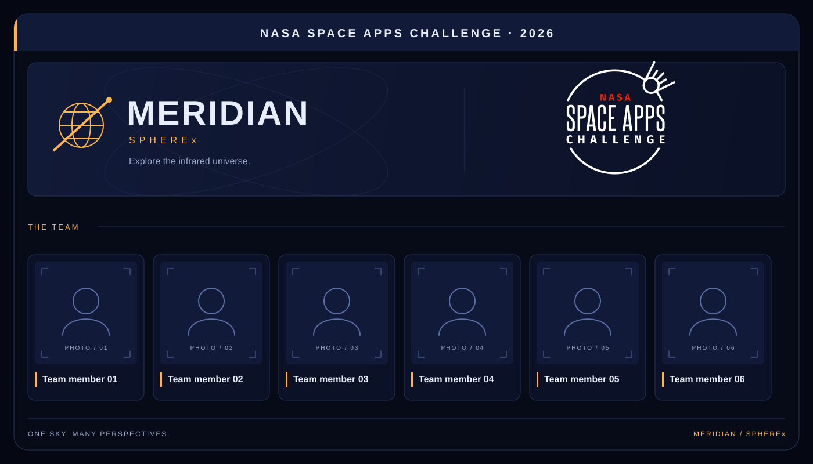

# Team header preview



A proposed header for the project README. Six placeholder cards show the structure; the final count, names, and photos can be updated together. The Meridian wordmark and orbit symbol are a draft treatment.

Uses the project colors from `web/src/style.css`: navy `#070b18`, panels `#0b1126` / `#111a38`, amber `#ffb547`, text `#e9eefb`, and muted blue `#9ba8cc`.

The official NASA Space Apps motif logo is from the [Space Apps brand assets](https://www.spaceappschallenge.org/brand/), preserved in its original white and color version in `nasa-space-apps.svg` and embedded as vector paths in the header.

## Team header in the README

The root README now uses `../img/readme/team-header.png`, with all six supplied portraits. Names are based on the photo filenames. Original photos remain in `../img/members_pictures/`.

To change names or order, edit `build-team-header.mjs`. Rebuild from the repository root with the web dependencies installed and Google Chrome available:

```bash
node docs/readme-preview/build-team-header.mjs
```

The script uses this original placeholder SVG as its template and renders a 2× PNG for sharp text on GitHub. The generated SVG in `../img/readme/` links to the original portraits; the README uses the self-contained PNG for reliable display.
